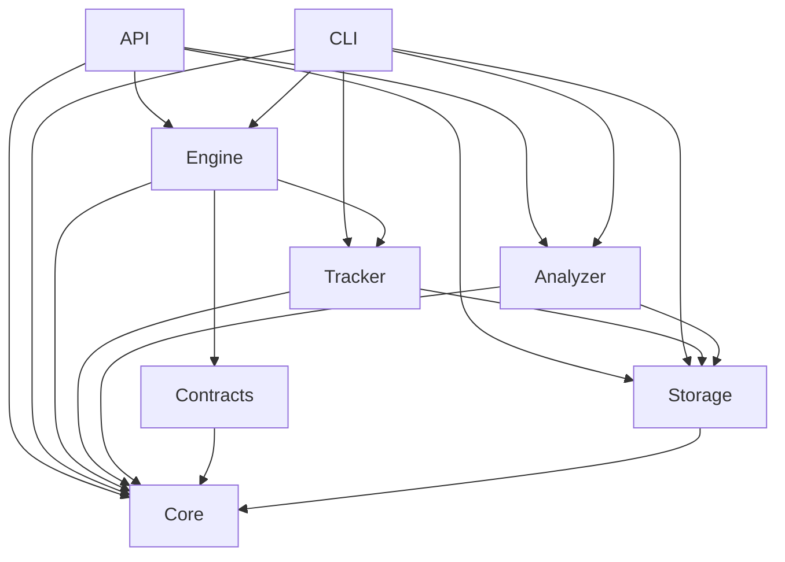

# Backend architecture

The backend has eight Cargo packages. Shared domain records live in core, storage
owns SQLite initialization/migrations, and the API provides the local host and
versioned contract. The engine implements YAML loading/validation, graph diagnostics, deterministic
serial scheduling, and materialized CSV/SQL execution. Tracker allocates durable
pending run/stage records; contracts and analyzer remain implementation boundaries.

| Crate | Ownership | Direct workspace dependencies |
| --- | --- | --- |
| `pipeline-autopsy-core` | Shared domain types, serialization, JSON Schema | None |
| `pipeline-autopsy-storage` | SQLite repositories, migrations, retention | core |
| `pipeline-autopsy-tracker` | Run/stage lifecycle and telemetry capture | core, storage |
| `pipeline-autopsy-contracts` | Contract validation and evaluation | core |
| `pipeline-autopsy-engine` | Specification planning, DAG scheduling, DuckDB execution | core, tracker, contracts |
| `pipeline-autopsy-analyzer` | Evidence investigations, candidate causes, downstream impact | core, storage |
| `pipeline-autopsy-api` | Local API adapters and application composition | core, engine, analyzer, storage |
| `pipeline-autopsy-cli` | CLI adapters and application composition | core, engine, analyzer, storage, tracker |

An arrow means “depends on”:



## Dependency rules

Core depends on Serde, schemars, chrono, and serde_json for representation; it has
no HTTP, filesystem I/O, SQL execution, or persistence dependencies. All consumers
use core's models rather than duplicating domain types.

Infrastructure crates depend inward toward core. Storage must not import the
engine or analyzer. Contracts must not import the engine: engine-specific queries
and orchestration belong in the engine, with contracts owning rule semantics.
The analyzer consumes recorded data rather than depending on the executor.
The API and CLI compose services at the outer boundary. Shared business behavior
must not depend on either transport. A future Tauri adapter can compose the same
services without moving domain logic into desktop commands.

Cargo manifests encode these allowed direct dependencies. New dependencies should
be reviewed against this direction; Cargo rejects dependency cycles. Concrete
repository interfaces and engine adapters will be defined when their first real
consumer is implemented, avoiding placeholder service APIs.

## Runtime and data flow

The application currently runs on the user's computer. A React/Vite frontend is
opened in the browser, and the Axum/Tokio process serves a local HTTP API. The
frontend is not yet integrated with the API. A future Tauri adapter can provide a
desktop window over the same domain/service boundaries.

Implemented API startup is:

```text
API process → create metadata directory → open SQLite pool
            → apply/validate embedded SQLx migrations → bind loopback listener
            → serve health and OpenAPI → graceful shutdown → close pool
```

Health reads the migrated database version. HTTP failures use the API's problem-
details adapter; raw SQL/database errors remain inside the storage boundary.
The OpenAPI document is generated from the same wire models the API crate owns.
Counts/durations use decimal-string transport DTOs to preserve u64 precision in
JavaScript; the core model and SQLite storage representations are separate.

The intended execution/investigation path for later tracks is:

```text
Pipeline definition + CSV/SQL files
  → engine validates/plans DAG and executes SQL in DuckDB
  → tracker captures stage lifecycle, counts, schema, and timing
  → contracts evaluates explicit expectations
  → storage persists run snapshots, checks, findings, and bounded evidence
  → analyzer investigates violations and traverses downstream impact
  → API/CLI present recorded results; frontend inspects them
```

Pipeline parsing, scheduling, and materialized CSV/SQL execution are implemented.
T3.1 registers pending run/stage identities. Execution telemetry, contract
evaluation, and diagnosis remain planned. DuckDB owns
intermediate execution data; SQLite owns persistent metadata. Historical
inspection should read stored records rather than rerun input queries. The
synthetic sales fixture documents the intended 190-order diagnosis.

## Current scope

T1.5 implements the shared [domain models](domain-models.md). T1.6 adds SQLx/SQLite
[metadata storage](storage.md), and T1.7 adds an Axum/Tokio host and the
[OpenAPI contract](api.md). Health and specification endpoints are implemented;
business endpoints are planned. T2.1–T2.7 add serde-saphyr YAML parsing, detailed petgraph DAG validation,
completion-gated serial scheduling, and isolated materialized DuckDB CSV/SQL
outputs. SQL stage files are parsed/validated with sqlparser before execution.
T3.1 adds atomic registration of pending run/stage/contract records; full telemetry
repositories, run failure/skip reports, and analysis services remain later work. [CI](ci.md) checks Rust and frontend builds
and tests. [Development](development.md) documents clean setup and operation.
These complete T1.8–T1.9. See [pipeline specification](pipeline-spec.md) for the
implemented Track 2 ingestion path and its limits.
