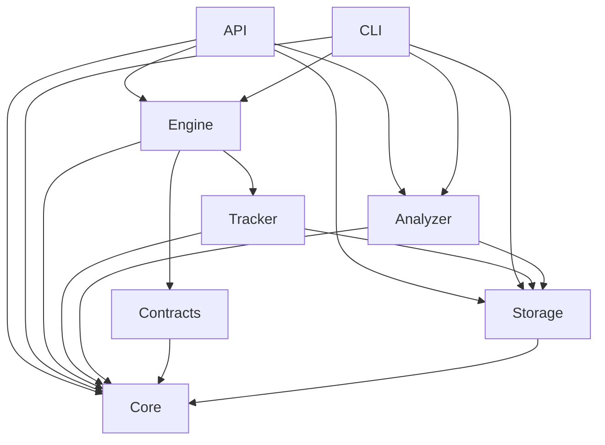

# Backend architecture

T1.4 establishes eight Cargo packages, keeping the existing `crates/core` and
`crates/cli` names. The six additional packages reserve their implementation
boundaries; they currently contain library documentation and dependency manifests.

| Crate | Ownership | Direct workspace dependencies |
| --- | --- | --- |
| `pipeline-autopsy-core` | Shared domain types, serialization, JSON Schema | None |
| `pipeline-autopsy-storage` | SQLite repositories, migrations, retention | core |
| `pipeline-autopsy-tracker` | Run/stage lifecycle and telemetry capture | core, storage |
| `pipeline-autopsy-contracts` | Contract validation and evaluation | core |
| `pipeline-autopsy-engine` | Specification planning, DAG scheduling, DuckDB execution | core, tracker, contracts |
| `pipeline-autopsy-analyzer` | Evidence investigations, candidate causes, downstream impact | core, storage |
| `pipeline-autopsy-api` | Local API adapters and application composition | core, engine, analyzer, storage |
| `pipeline-autopsy-cli` | CLI adapters and application composition | core, engine, analyzer, storage |

An arrow means “depends on”:

## Dependency rules

Core depends on Serde, schemars, chrono, and serde_json for representation; it has
no HTTP, filesystem I/O, SQL execution, or persistence dependencies. All consumers
use core's models rather than duplicating domain types.

Infrastructure crates depend inward toward core. Storage must not import the
engine or analyzer. Contracts must not import the engine: engine-specific queries
and orchestration belong in the engine, with contracts owning rule semantics.
The analyzer consumes recorded data rather than depending on the executor.
The API and CLI compose services at the outer boundary. Shared business behavior
must not depend on either transport. A future Tauri adapter can compose the same
services without moving domain logic into desktop commands.

Cargo manifests encode these allowed direct dependencies. New dependencies should
be reviewed against this direction; Cargo rejects dependency cycles. Concrete
repository interfaces and engine adapters will be defined when their first real
consumer is implemented, avoiding placeholder service APIs.

## Current scope

T1.5 implements the shared [domain models](domain-models.md). The transport and
service crates are buildable shells. Axum/Tokio, DuckDB, petgraph, and SQLx will be
introduced alongside their implementations. The API server, database schema,
OpenAPI contract, and CI are later tasks (T1.6–T1.8 and Track 2 onward).
